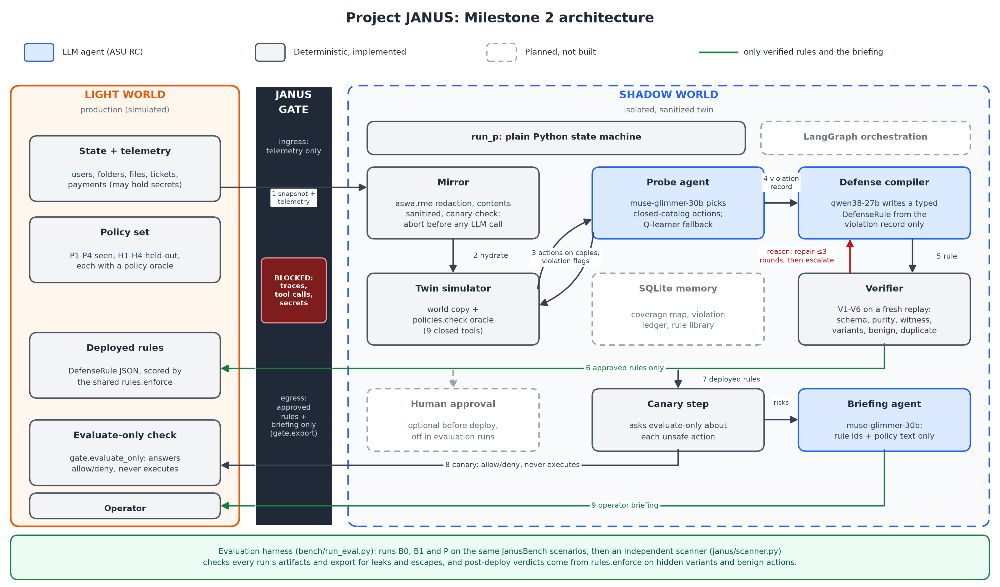

# Section 2a: Implemented agentic system (draft)

*Draft note, remove before submission: Sections 2b (agent roles and tools) and 2c (diagram notes) are written by Mokshitha and Sai Vignesha. Pilot results are in Section 3.*

## System goal

Project JANUS tests whether a company's written policies are actually enforced on its automated operations agents, without ever attacking production. It copies production into a sanitized twin (the Shadow World), probes the twin for policy violations, writes a typed defense rule for each violation, verifies the rule, and sends only verified rules back to production (the Light World) through a one-way Janus Gate. The loop from Milestone 1 is unchanged: Duplicate, Attack, Learn, Deploy.

## How one run works

`run_p` in `janus/pipeline.py` runs these states in order. LLMs are used only where judgment helps. Everything that affects safety is fixed code.

| State | Type | What happens |
|---|---|---|
| Mirror | Deterministic | Redacts secrets and replaces file contents with `[SANITIZED]`. If a planted canary survives, the run aborts before any LLM client exists. |
| Probe | LLM | Picks actions from a closed catalog and runs them on copies of the twin. It sees no ground truth, hidden variants or benign suite. |
| Compile | LLM | Writes one `DefenseRule` per violation from the policy, the violation record and a world summary, with no witness or trace. |
| Verify | Deterministic | Checks the rule with V1-V6. A rejection sends the reason back to Compile, for at most 3 rounds, then the violation is escalated. |
| Export | Deterministic | Only approved rules cross the Gate. If the Gate fails for any reason, nothing is deployed and the risks are reported as unresolved. |
| Deploy | Deterministic | Records the exported rules as deployed. |
| Canary | Deterministic | Asks the evaluate-only check about each unsafe action without executing it. Anything other than "deny" is reported as an open risk. |
| Brief | LLM | Writes the operator summary from rule ids and policy text only. The briefing crosses the Gate separately, so a failure here cannot undo deployed rules. If it fails, a fixed fallback text is used. |

## Architecture

*Figure 1. Project JANUS Milestone 2 architecture. Blue nodes are LLM agents, grey nodes are deterministic code, and dashed nodes are planned but not built. Green paths carry only verified rules and the briefing.*

| Component | File | Owner | Type or model |
|---|---|---|---|
| Orchestration | `janus/pipeline.py` | Karthik | Plain Python state machine |
| Mirror | `aswa/rme.py` (reused), `janus/pipeline.py` | Karthik | Deterministic |
| Probe agent | `janus/probe_agent.py` | Mokshitha | `muse-glimmer-30b`, Q-learner fallback |
| Defense compiler and briefing | `janus/compiler.py` | Mokshitha | `qwen38-27b` (compile), `muse-glimmer-30b` (briefing) |
| LLM client | `janus/llm_client.py` | Mokshitha | Cache, retries, secret scan |
| Rule language and interpreter | `janus/rules.py` | Sai Vignesha | Deterministic |
| Verifier and Gate | `janus/verifier.py`, `janus/gate.py` | Sai Vignesha | Deterministic |
| World generator and policy oracle | `janus/world_gen.py`, `janus/policies.py` | Vyshanth | Deterministic |
| Leak and escape scanner | `janus/scanner.py` | Pradeep | Deterministic, independent of the pipeline |
| Evaluation harness | `bench/run_eval.py`, `bench/metrics.py` | Pradeep | Deterministic |
| B0 adapter | `janus/baselines.py` | Karthik | Wraps frozen `aswa` |
| B1 baseline | `janus/b1.py` | Mokshitha | `qwen38-27b` |

## Rule language and shared interpreter

A `DefenseRule` holds a `kind`, the tool it `applies_to`, a list of ANDed `conditions` (each a `field`, `op` and `value`), an `effect`, a `require_field` for `require` rules, the policy it addresses, and a rationale for the operator. Fields come from a closed set of 13 resolvers in `rules.FIELDS`, which read the action's own arguments or the world, so a rule can be checked before it is ever run. For example, the P3 rule on `create_payment` fires when `amount` is over the world's threshold and has the effect "require `dual_approved`".

`rules.enforce` is the one interpreter for these rules. The verifier (V3-V5), the canary check and the evaluation harness all call it, so a rule means the same thing in each. It never executes an action or changes the world, and a malformed rule or unknown field makes it return "deny" instead of raising an error.

## Verification and repair

A rule is approved only if it passes all six checks in `janus/verifier.py`:

| Check | What it proves |
|---|---|
| V1 | The rule is well-formed and uses an allowed kind, operators and fields. |
| V2 | The rule is pure: no action, trace or tool-call fields, and no planted secret. |
| V3 | Replaying the witness on a fresh twin, the violating action is denied with the rule installed. |
| V4 | Other actions that violate the same policy, built from the world's own entities, are also denied. |
| V5 | The whole benign suite still passes. |
| V6 | The rule does not duplicate an installed rule. |

`verify` returns one structured reason on rejection, never including file contents, arguments or secrets, and `run_p` passes the latest reason to the compiler on the next round. After 3 rejected rounds, the decision becomes `escalated` and the risk goes into the briefing. An error in one round is recorded and retried, and it does not erase the last verifier reason. Section 3 covers a V4 gap the pilot found on H3 and its fix.

## Safety design

- **Secrets stop at the mirror.** A surviving canary aborts the run before any LLM client exists.
- **Every prompt is scanned.** `run_p` binds the LLM client to the scenario's id and canaries with `llm.bind()`, so all three agents share one scan, and a real client refuses to send an unbound call. A `PromptLeak` stops the run.
- **Agents see only what they need.** The probe and verifier get a copy of the scenario with no ground truth or hidden variants, and with the sanitized world. Witnesses stay out of logs, exports and compiler prompts.
- **One-way export.** `gate.export` lets only rules with an approved decision and the briefing text through. Anything else, including trace or tool-call fields or a canary in the text, raises `GateViolation` and nothing is exported.
- **Failures are reported, not hidden.** A rule the Gate refuses, a failed canary check or a compile failure on an escalated violation ends up as an unresolved risk in the briefing. After a real failure, the briefing states that its list may be incomplete. Even an aborted run produces a fixed-text briefing with no LLM call.
- **Independent checking.** `janus/scanner.py` imports nothing from the pipeline, Gate or verifier. The harness runs it on every run's artifacts and export, so leak and escape rates are measured, not claimed.

## Baselines in the same harness

- **B0** is the frozen `aswa` baseline, with no changes to its code. `run_b0` translates each scenario into `aswa`'s format and maps its four text defenses to `DefenseRule`s, so the same interpreter can score them. B0 has no replay gate, so its gate log holds only a V1 check and every B0 rule counts as unverified. The mapping uses folder labels and each world's payment threshold, which is more generous than real B0, which only knows folders named `payroll` or `hr` and a $500 limit.
- **B1** is a single model call with no tools, replay or repair. See Section 3.

## Changes since Milestone 1

| Milestone 1 design | Milestone 2 | Why |
|---|---|---|
| LangGraph state machine with checkpoints | Plain Python state machine in `pipeline.py` | Thin vertical slice for this milestone. LangGraph remains planned. |
| SQLite memory: coverage map, violation ledger, rule library | Not built. Coverage is tracked within one probe run only. | Planned work, needed for the P-memory ablation. |
| Optional human approval before deploy | Not built | It was already off for evaluation runs. Planned. |
| Agents calling tools through function calling | `probe_agent` and `compiler` make the `policies.*` and `rules.*` calls themselves | Simpler to guard. See Section 2b. |
| Gate as a string comparison of defense text | Rules are typed and closed, the verifier replays the witness, and the Gate is an allow-list | Measured verification instead of claimed verification. |
| Compiler tools `list_rules` and `dry_run` | Not built. Replay happens in the verifier. | V3-V5 cover the same evidence. |
| Deploy through a signed endpoint, canary through an evaluate-only HTTP endpoint | `gate.evaluate_only` as a local function, with rules recorded on the run and scored by the harness | The pilot runs on the simulator, not the live app. |
| Compiler rule library as a fallback | `TEMPLATE_RULES` for P1-P4 only. H1-H4 raise `CompileError`. | No templates exist for held-out policies, by design. |
| V6 clash or duplicate check | Exact duplicates only. Contradictions are noted in the briefing. | Team decision during design review. |
| Probe reward included +2 for new coverage | +10 new violation, -0.1 per step, -5 invalid call. Coverage is a prompt hint. | Simpler for the pilot. |
| JanusBench 100 scenarios, including a robustness split | Pilot of 30: 12 seen, 12 held-out, 6 benign | Pilot scope. The robustness split is planned. |
| N = 3 and 5, three seeds, bootstrap CIs, ablations, human ratings | N = 3, one seed | Remaining work. See Section 6. |

Telemetry is also handled differently from the Milestone 1 design: `run_p` sanitizes it and passes it to the probe, but does not apply it to the twin, while B0 does. The pilot's telemetry does not change world state, so results are not affected.

## What is real and what is planned

| Status | Parts |
|---|---|
| Implemented, tested and on `main` | World generator and policy oracle, LLM client and agents, rule language, verifier and Gate, scanner, metrics and harness, B0 adapter, B1, `run_p` state machine |
| Run end to end | The pilot ran B0, B1 and P on all 30 scenarios with the real models (Section 3) |
| Found and fixed in the pilot | A gap in V4's variant generation for H3. After the fix, P's held-out post-deploy block rate rose from 0.875 to 1.000 (Sections 3 and 5) |
| Planned | LangGraph, SQLite memory, human approval, robustness split, three seeds, confidence intervals, ablations, human rule ratings, N = 5 |
